<div align="center">

```text

     ██╗██╗   ██╗██╗     ██╗ █████╗     ██╗      █████╗ ███████╗ █████╗ ███████╗██╗     ██╗  ██╗   ██╗
     ██║██║   ██║██║     ██║██╔══██╗    ██║     ██╔══██╗██╔════╝██╔══██╗██╔════╝██║     ██║  ╚██╗ ██╔╝
     ██║██║   ██║██║     ██║███████║    ██║     ███████║█████╗  ███████║█████╗  ██║     ██║   ╚████╔╝ 
██   ██║██║   ██║██║     ██║██╔══██║    ██║     ██╔══██║██╔══╝  ██╔══██║██╔══╝  ██║     ██║    ╚██╔╝  
╚█████╔╝╚██████╔╝███████╗██║██║  ██║    ███████╗██║  ██║██║     ██║  ██║███████╗███████╗███████╗██║   
 ╚════╝  ╚═════╝ ╚══════╝╚═╝╚═╝  ╚═╝    ╚══════╝╚═╝  ╚═╝╚═╝     ╚═╝  ╚═╝╚══════╝╚══════╝╚══════╝╚═╝   

──────────────────────────────────────────────────────────────────────────────────────────────────────

Curso: Engenharia de Software — UNICID
Foco: Desenvolvimento Web
Estudando: Front-End • Back-End • Estrutura de Software

```

</div>

## 👩‍💻 Sobre mim

```java
public class Julia {
    String curso = "Engenharia de Software";
    String foco = "Desenvolvimento Web";
    String[] estudando = {
        "HTML", "CSS", "JavaScript",
        "Lógica de Programação", "Banco de Dados", "Java"
    };
    String objetivo = "transformar ideias em soluções por meio do código";
}

```
Busco uma oportunidade de estágio ou posição júnior em Engenharia de Software, na qual possa aplicar meus conhecimentos, desenvolver minhas habilidades técnicas, aprender com profissionais da área e contribuir para a criação de soluções tecnológicas.

Estou aberta a novas conexões, aprendizados e oportunidades na área de tecnologia. Fique à vontade para entrar em contato e trocar experiência.

**Acesse meu Portfólio:**

[](https://julialafaelly.github.io/Meu-Portfolio/)

---

## 🧠 IDE's


---

## 🎨 Front-End


---

## 🛠 Back-End


---

## 🗄 Banco de Dados


---

## 🔧 Controle de Versão


---

## 🤖 Inteligências Artificiais (IA)

[](https://manus.im/)
[](https://claude.ai/)
[](https://chatgpt.com/)

---

## 🎓 Formação

**ETEC Itaquera I**

- Técnico em Desenvolvimento de Sistemas — Concluído.

**Universidade Cidade de São Paulo (UNICID)**

- Bacharelado em Engenharia de Software — Em andamento.


---

<picture data-importer="pacman">
  <source media="(prefers-color-scheme: dark)" srcset="https://raw.githubusercontent.com/julialafaelly/julialafaelly/pacman-output/pacman-contribution-graph-dark.svg?game=pacman">
  <source media="(prefers-color-scheme: light)" srcset="https://raw.githubusercontent.com/julialafaelly/julialafaelly/pacman-output/pacman-contribution-graph.svg?game=pacman">
  
</picture>

---

**Entre em Contato:**

[](https://wa.me/5511947838757)
[](https://www.linkedin.com/in/julialafaelly-frazao/)
[](mailto:julia.lafaelly@gmail.com)
